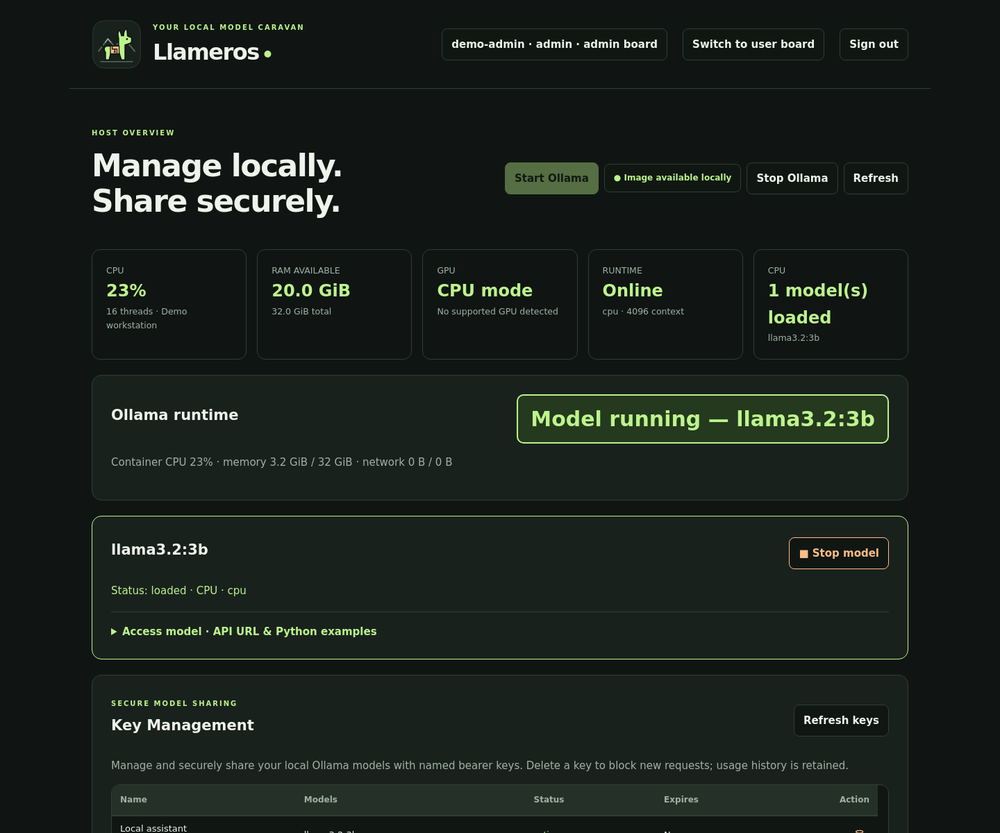
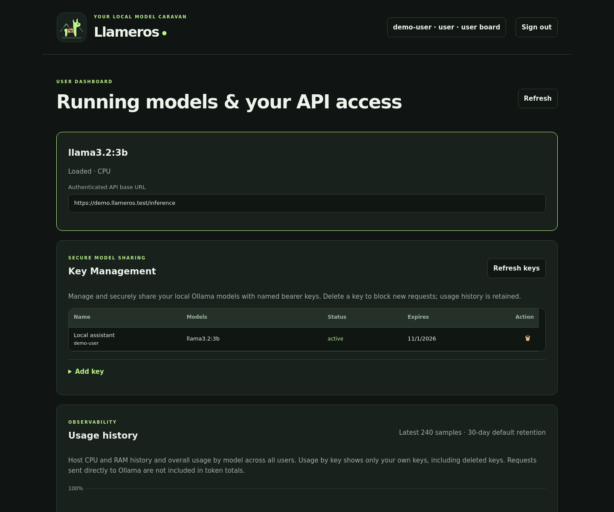

# Dashboard history

### Adaptive benchmark stress tests

After six existing speed cases, benchmarks rotate through those workloads in an
open-loop stress test. Starting at 1 request/minute, clean stages double the rate
and failed stages halve it. If the initial stage succeeds, scale up until the
first failed stage, then stop automatically. If the initial stage fails, scale
down until the first successful stage, then stop automatically. Stages offer at least six requests over at least one
minute and drain pending work before moving on. The current queue size, timeout,
and parallelism are exercised using an isolated production scheduler. The queue
timeout also bounds a full stress request, including waiting and response time.
Synthetic failures stay in benchmark metrics, not activity/error logs or quotas.

No overall benchmark deadline applies. Use **Stop benchmark** in Ollama status;
service shutdown also stops it. Until completion or manual stop, the gateway remains reserved and
returns HTTP 503. Completed speed metrics are saved before the load phase, and
load results are saved after every stage and on manual stop. Details include the
highest clean tested rate and latest 200 stages. This is an observed estimate for
the workload mix, not proof that a rate is sustainable permanently. Stress tests
use one synthetic account and do not measure fairness across distinct users.

### Runtime recovery and restart errors

New managed CPU/GPU Ollama containers use `--restart unless-stopped`. Existing
owned, compatible running containers receive the policy in place during status
checks; stopped containers receive it when started. Explicit Stop remains stopped.
No unrelated or archived containers are modified.

Docker restart-count increases and observed start-timestamp changes are persisted
as `container-restart:failed` admin activity entries, including changes first seen
after a Llameros restart. Multiple automatic restarts between checks produce one
error with the restart-count delta. Initial discovery reports an existing nonzero
restart count; ordinary first starts, container replacements, and controlled
Llameros starts do not produce timestamp-only errors. Restarts are detected during
container inspection (periodic sampling by default); this is not a Docker event
stream, so intermediate timestamp-only restarts cannot be counted individually.

The User Activity chart and legend share five distinct colors: green input tokens,
amber output tokens, blue requests, red failures, and purple maximum queue size.

### Scheduler configuration

Administrators can edit **Configuration → Scheduler**. Defaults are 16 waiting
requests per hardware target, a 120-second queue timeout, 2 parallel Ollama
requests, and 0 (unlimited) distinct waiting users. A user is an authenticated
Linux account, shared across its API keys. The distinct-user limit is per target
and counts waiting users only, not executing requests. A user already waiting may
add requests up to the request limit. Limits reject excess admission with HTTP
429; expired waiting requests receive HTTP 504. Lowering limits does not cancel
existing tickets, although a shorter timeout applies to their elapsed wait.

Saved dashboard settings persist in the private state directory's `scheduler.json`
and override the TOML parallelism value on subsequent service starts. Queue
settings apply immediately. To change Ollama parallelism, wait for all jobs and
requests to finish, stop all Ollama runtimes, save and confirm container recreation,
then start Ollama and reload models. Container recreation is necessary to update
`OLLAMA_NUM_PARALLEL`; model files and the configured storage location are retained.

User Access, Scheduler, and Model storage are independent, initially collapsed
items inside Configuration. Scheduler options use an aligned option/value table.

User Activity plots tokens, hourly requests, failed requests, and maximum waiting
queue size in one chart. Tokens use the left axis; requests and queue depth use
the right axis. Failures are red and included in total requests; queue peaks are
purple. Queue depth excludes executing requests. All users shows the simultaneous
combined waiting depth across devices; selecting an account shows only that
account's waiting depth. Peaks are recorded on admission and during sampling,
persist for 90 days, and cannot be backfilled from older history. Requests with an
authenticated key are counted even when token usage is unknown. Unauthenticated
failures remain in activity logs, but cannot be attributed to a user. On upgrade,
request counts are backfilled from retained request rows only, so older hourly
token totals may have incomplete corresponding request counts.

Admin cards have disclosure controls. Ollama status, running models, and model
catalogue/download cards start expanded; other admin cards start collapsed.
Usage history offers Hardware usage and User Activity tabs. User Activity shows
hourly UTC input/output token totals, aggregated across users by default, with an
individual-user selector. Ordinary accounts can only retrieve their own hourly
totals. Direct-to-Ollama traffic is excluded; requests without reported token counts
are excluded from token totals but still contribute to request counts.

Activity logs support last 24 hours, last week (7 days), last month (30 days), and
all retained entries. Request, admin-event, and security logs are automatically
pruned after 90 days (the three-month retention window); configured row limits can
remove entries earlier. Hardware history retains its existing configured policy.
Hourly token totals are retained separately for 90 days, independently of request
row limits. Existing retained requests are backfilled once on upgrade; already
deleted history cannot be recovered. Failure acknowledgement remains independent
of the selected time frame and retention cleanup.

<p align="center">
  
</p>

# Llameros

**Light weight Ollama manger: setup and securely share your local Ollama models.** 

**Usage scenario**: you want to share LLMs running on a **single** local sever/workstation with **multiple** users. *LLameros* is easy to setup and provides a simple web-interface which helps you to serve and mange acess to language models.  

## Key Features:
* easy setup - **no sudo** privileges needed!
* run models securely in rootless Docker
* CPU, multi-GPU and multi-model support
* Hardware / usage monitoring 
* model search, automatic model recommendation, download and management 
* model benchmarking
* multi-user support - authentication via host PEM (e.g. local users, LDAP, ...)
* HTTPS gateway
* web-ui API key-management (fine grain user and model token-limits)
* modern API support (streaming, responses  ...)


## Dashboard previews

Screenshots of the actual dashboard rendered with synthetic demo data, not a live
deployment. No real accounts or credentials are shown.

### Admin board

Host telemetry, runtime controls, loaded models, and key management.



### User board

Shared running models and resource history, with owner-scoped API keys and usage.



## Quick start

Requires **Linux, Python 3.11+, uv, Docker, and PAM**. GPU execution needs compatible
host drivers and container support. Run as your normal user, never sudo.

```bash
# Run from the repository root.
uv sync --locked
uv run llameros
```

Open **https://127.0.0.1:8443**, verify/trust your generated certificate, and sign in
with your Linux account. The account running Llameros defaults to admin; other login accounts default to users. Start Ollama, download a model, select a
free CPU/GPU slot, and load it.

> Rootless Docker is required by default. Runtime APIs are private to the service;
> clients use the authenticated HTTPS gateway. See the installation guide for
> migration of existing containers and explicit rootful risk acceptance.

## Access a model from Python

With a model loaded, create a key in **Key Management → Add key** and copy the
one-time secret. All active users can create **All models** or model-specific keys
without an admin grant. Keys work on all CPU/GPU targets; expiry is optional.
Download the server certificate next to the key-generation controls and verify it
before use.

Install `httpx` (`python -m pip install httpx`; already included in Llameros), then
set your key and verified server certificate or CA bundle in Bash:

```bash
read -rsp 'Llameros API key: ' LLAMEROS_API_KEY; echo
export LLAMEROS_API_KEY
export LLAMEROS_CA_CERT="/absolute/path/to/verified-llameros-certificate.pem"
```

Use the HTTPS address shown under **Access model** and adjust the model tag and
target below to a loaded instance allowed by your key. `X-Llameros-Target` selects
the CPU/GPU instance and is required when the model is loaded on multiple targets.

```python
import os
import ssl

import httpx

tls = ssl.create_default_context(cafile=os.environ["LLAMEROS_CA_CERT"])
with httpx.Client(
    base_url="https://127.0.0.1:8443/inference/",
    verify=tls,
    timeout=180.0,
    headers={
        "Authorization": f"Bearer {os.environ['LLAMEROS_API_KEY']}",
        "X-Llameros-Target": "cpu",
    },
) as client:
    response = client.post(
        "api/chat",
        json={
            "model": "llama3.2:3b",
            "messages": [{"role": "user", "content": "Say hello in one sentence."}],
            "stream": False,
            "options": {"num_predict": 256},
        },
    )
    response.raise_for_status()
    print(response.json()["message"]["content"])
```

Use the API key, not your Linux password. Keep TLS verification enabled and keys
private; unset `LLAMEROS_API_KEY` after use and revoke unwanted keys in the dashboard.
See [API compatibility](api-compatibility.md) for other endpoints and streaming.

## Documentation

| Guide | Contents |
|---|---|
| [Installation & usage](install.md) | Setup, configuration, storage, model workflow, GPU runtimes, and client access |
| [API compatibility](api-compatibility.md) | Full API ducumentation
| [Troubleshooting](trouble_shooting.md) | Unavailable CPU/GPU slots, container migration, login, downloads, and API issues |
| [Development guide](development.md) | Contributor setup, architecture, documentation conventions, tests, acceptance checks, and security model |
| [Security audit](Security_Audit.md) | Current security findings, validation evidence, limitations, and outstanding deployment checks |


---

MIT licensed. Llameros: the people who manage llama caravans through the Andes.

<p>
  <a href="https://github.com/keuperj/Llameros" target="_blank" rel="noopener noreferrer">View on GitHub ↗</a>
  · <a href="https://www.llm-praxis.de/" target="_blank" rel="noopener noreferrer">maintained by LLM-Praxis</a>
  · <a href="https://www.keuper-labs.org/" target="_blank" rel="noopener noreferrer">developed by Keuper-Labs</a>
</p>
<p align="right">
Supported by
  
  
</p>
