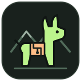

<p align="center">
  
</p>

# Llameros

A Python, local-first web interface for Ollama on Linux. Manage a dedicated Ollama
Docker container, discover models, estimate hardware compatibility, and inspect
current and historic usage. No Node.js build, cloud account, or external UI assets.

## Quick start

Requires Linux, Python 3.11+, Docker CLI, an accessible **local** Docker daemon,
and the system PAM library. GPU support additionally requires compatible drivers
and Docker GPU configuration. Start Llameros as your normal Linux user, never sudo.

From your local project checkout (replace `/path/to/Llameros` with its location):

```bash
cd /path/to/Llameros
uv sync --extra dev
uv run llameros
```

Open `https://127.0.0.1:8443`. A self-signed certificate is generated automatically;
your browser will warn because it is not signed by a trusted CA. Verify/trust your
own certificate before entering your Linux password. Sign in with the **same Linux
username and password as the user running Llameros**.
There is no default password, separate user database, or authentication bypass.

The dashboard works without Docker; Docker errors appear in the runtime panel.
Rootful Docker is **refused by default**. Prefer configuring rootless Docker.
If you deliberately accept the root-equivalent access risk, copy the example config and set
`allow_rootful_docker = true`. Llameros does not change your Docker setup.

```bash
mkdir -p "$HOME/.config/llameros"
cp /path/to/Llameros/config.example.toml "$HOME/.config/llameros/config.toml"
uv run llameros --config "$HOME/.config/llameros/config.toml"
# Command-line overrides:
uv run llameros --host 127.0.0.1 --port 9443
```

Without uv, use a Python virtual environment and `pip install -e '.[dev]'`, then
run `llameros`. The committed `uv.lock` pins the tested dependency set.

## Features and workflow

1. Inspect CPU cores/utilization, available RAM, and detected GPU VRAM. NVIDIA
   uses `nvidia-smi`; AMD/Intel inspection falls back to Linux DRM sysfs where
   available. Missing telemetry is shown as unknown rather than invented.
2. Start Ollama using **Start Ollama**. First launch downloads the configured
   Docker image and may take several minutes. Operations run as background jobs
   and the panel reports progress/errors.
3. Browse the live official Ollama library, choose a family and tag, and review
   its download size and estimated memory requirement. Download is enabled for
   variants estimated to fit available system RAM. The catalogue lists the
   families exposed by the library page; it is not an exhaustive registry API.
4. Download, load/start, and unload/stop models. Loading keeps a model resident;
   unloading releases it. Stopping the container stops all its models. Downloaded
   weights persist in the `llameros-<uid>-models` Docker volume by default, or in
   the host directory selected in the **Model storage** panel. The **Downloaded
   models** panel shows the models available in the selected location.
5. Use the inference playground to record token counts and timing. Generation
   runs asynchronously, returning up to 256 tokens from the UI (API limit 4096).
6. Inspect sampled host CPU/RAM history, container CPU/memory/network usage,
   loaded-model snapshots, lifecycle events, and per-model inference totals.

## Configuration

### Model storage in the GUI

The **Model storage** panel lets you select a dedicated host directory, including
paths beginning with `~`. Leave the path empty to use the original Docker-managed
volume. New directories are created with private permissions; existing directories
must be owned by the current user, not group/other-writable, and contain only
Ollama's `blobs` and `manifests` directories (or be empty). Symlinks are rejected.
Choose the **models directory itself**, not its parent `.ollama` directory.

Stop Ollama, enter the location, check the confirmation, and select **Save storage
location**. The operation shares the lifecycle job lock with downloads/inference.
It removes only the stopped managed container; the next start creates it with the
selected storage mount. Model data is **never automatically copied or deleted**.
Switch back to the previous location to see its models again. To relocate models,
copy `blobs` and `manifests` yourself while Ollama is stopped, preserving access
permissions. Back up important data before doing so.

The preference is saved privately in `model-storage.json` inside the configured
application state directory and survives restarts; it does not rewrite TOML.
The selected directory is mounted read/write at `/models` with `OLLAMA_MODELS`
pointing there. Only select model data you intend the container to access. Docker
and Ollama must have suitable filesystem permissions; rootless setups may require
additional permission configuration. Llameros does not sudo or change ownership.

The **Downloaded models** panel displays names, sizes, modification dates (when
available), and loaded/downloaded status. While Ollama runs, its API is authoritative.
While stopped, host directories are scanned for manifests and complete referenced
blob sizes (checksums are not recomputed). Docker volumes show a timestamped,
last-known inventory, not a claim of current contents. Start Ollama to populate or
refresh that inventory. Only models in the selected store are listed; Llameros
does not search unrelated directories or other Docker volumes. Existing custom
models can be listed, but lifecycle controls still accept official library names only.

### Application settings

The default config is `~/.config/llameros/config.toml`, beneath the current user's
home directory. See `/path/to/Llameros/config.example.toml` in your checkout for
all settings. Home-directory paths beginning with `~` in the configuration are
expanded for the user running Llameros.

| Setting | Default | Purpose |
|---|---|---|
| `host`, `port` | `127.0.0.1`, `8443` | HTTPS binding; ports must be unprivileged |
| `state_dir` | Current user's `.local/share/llameros` | TLS files and SQLite history |
| `cert_file`, `key_file` | Empty | Optional existing PEM certificate and private key |
| `pam_service` | `login` | Existing Linux PAM service |
| `session_seconds` | `3600` | Absolute session lifetime |
| `sample_seconds` | `15` | Resource collection interval |
| `retention_days` | `30` | History retention, pruned during sampling |
| `ollama_port` | `11435` | Ollama API, published only on IPv4 loopback |
| `ollama_image` | `ollama/ollama:latest` | Image; pin a tested tag/digest for reproducibility |
| `gpu` | `cpu` | `cpu`, `nvidia`, or `amd`; AMD defaults to the ROCm image |
| `context_length` | `4096` | Runtime context length |
| `allow_rootful_docker` | `false` | Explicit rootful daemon risk acceptance |

Configuration changes to an existing container do not recreate it. Stop it and
remove the **container only** with `docker rm llameros-$(id -u)` before restarting
to apply image/GPU/port changes. Keep the model volume to preserve downloads.
Only one Llameros instance per Linux UID and Docker daemon is supported.

## Security model and limitations

- The application does not sudo, read shadow files, switch identity, or create
  privileged host helpers. Linux PAM authenticates the current user and checks
  account policy. PAM configuration differs by distribution; test it locally.
  Passwordless, locked, MFA-only, and expired-password accounts may not support
  this simple username/password flow. Do not weaken PAM or run as root to fix it.
- Rootless Docker is the default requirement. Docker-group membership/rootful
  socket access already carries root-equivalent authority, even if this web
  process has an ordinary UID. Rootless mode does not eliminate kernel risks.
- HTTPS is mandatory; the CLI refuses root/setuid execution. Sessions are opaque,
  in memory, expire absolutely, and disappear on restart. Cookies are Secure,
  HttpOnly, SameSite=Strict, and host-only. Mutations require matching HTTPS Origin
  and CSRF token. Login attempts are globally limited to five per minute; a hostile
  client can therefore temporarily deny login. No CORS or proxy-header trust.
- No shell execution or browser-supplied Docker arguments, image names, devices,
  or hosts. The authenticated storage setting permits only a validated, dedicated
  directory mount to a fixed container destination. Only official library model
  names are accepted for lifecycle operations. Container
  ownership labels are checked. Containers have capabilities dropped,
  no-new-privileges, bounded logs/PIDs, no Docker socket mount, and no automatic
  restart. These measures are defense in depth, not a sandbox guarantee.
- Ollama's API is **not authenticated** on loopback. Other local processes can
  access it directly. Do not publish its port on a LAN. Keep Llameros bound to
  loopback unless you understand the additional exposure; no public-Internet
  deployment, reverse proxy, or multi-user hosting is supported in this MVP.
- CPU is supported by default. NVIDIA needs NVIDIA Container Toolkit; AMD needs
  ROCm-compatible hardware, devices, and permissions. Rootless GPU setups may
  require additional administrator configuration. Integrated-GPU memory may be
  shared with RAM and is not double-counted. Validate GPU execution on your target
  hardware before relying on it.
- Fit estimates are **heuristics**, not guarantees: weights × 1.25 + 2 GiB runtime
  allowance, with 1 GiB host reserve. They do not fully model KV cache, architecture,
  long contexts, MoE, disk capacity, or concurrent processes. RAM and VRAM are not
  simply summed. Large contexts may still exhaust memory. Runtime checks are
  repeated before downloads/loads; GPU availability can change afterward.
- Official catalogue HTML and registry manifests are fetched over HTTPS and
  cached for ten minutes. HTML parsing can break if Ollama changes its site.
  Network access is needed to discover/download models; installed models can run
  offline. Cloud-only/unsupported manifests without downloadable layers are rejected.
- Resource history is sampled only while Llameros is running. Per-model token and
  timing totals cover **only requests through Llameros**, not direct Ollama clients.
  Container metrics cannot reliably be attributed to individual models. Models
  can remain running when the dashboard exits; stop the container explicitly.
- Passwords, prompts, and responses are not saved in SQLite. The latest response
  exists temporarily in the in-memory job result and browser. Database/state files
  are private to the current user. Back up the database only if you want to retain
  usage history. This is an initial implementation, not a security-audited product.

## Development

```bash
cd /path/to/Llameros
uv sync --extra dev --locked
uv run pytest
uv run ruff check .
uv run ruff format --check .
node --check /path/to/Llameros/src/llameros/static/app.js
```

Tests use fake PAM/Docker/catalogue services; they do not use your password,
download large models, or modify your Docker daemon. A successful real PAM login
and GPU/container inference need local acceptance testing on the target host.

MIT licensed. Llameros: the people who manage llama caravans through the Andes.
